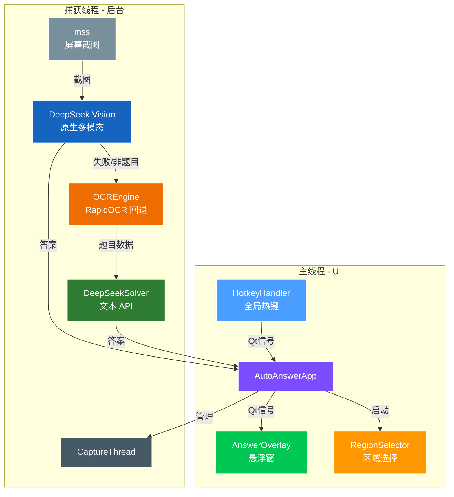

# 🧠 AutoAnswer 智答助手 — AI 智能屏幕答题工具


> **AutoAnswer — AI-Powered Screen Quiz Solver with Native Vision**
>
> **智答助手 — 基于 DeepSeek 原生视觉的屏幕智能答题工具**

一款基于 AI 的桌面答题神器。框选屏幕区域，程序自动截图，**优先把整张截图交给 DeepSeek 多模态模型直接读题作答**；当视觉调用失败、超时或识别不到题目时，自动回退到 RapidOCR 提字 + 文本模型作答。结果直接显示在半透明悬浮窗上。支持**单选题、多选题、判断题、填空题、简答题**，多选答案会完整列出全部正确选项。内置全局快捷键一键框选、暂停、手动触发识别，轻量、快速、安静。

> ⚠️ **隐私提示：** 使用视觉模式时，**捕获区域的截图会通过 HTTPS 上传至 DeepSeek API** 用于识别作答。请勿框选包含密码、聊天记录、证件等敏感信息的区域。可在 `config.py` 中设置 `USE_DEEPSEEK_VISION = False` 关闭截图上传，改为纯本地 OCR + 文本 API。

---

## 📖 目录

- [项目简介](#-项目简介)
- [功能特性](#-功能特性)
- [系统架构](#-系统架构)
- [快速开始](#-快速开始)
- [配置说明](#-配置说明)
- [快捷键](#-快捷键)
- [项目结构](#-项目结构)
- [性能指标](#-性能指标)
- [常见问题](#-常见问题)
- [开发计划](#-开发计划)
- [许可证](#-许可证)

---

## 🔍 项目简介

**AutoAnswer 智答助手** 是一款结合实时屏幕捕获、多模态大模型推理与本地 OCR 的桌面智能答题工具。

它在后台静默运行，持续监控用户指定的屏幕区域。当检测到新题目时，直接把截图交给 DeepSeek 视觉模型识别题干、选项与题型并给出答案；视觉不可用时，自动改用 RapidOCR 提取文字，再交给 DeepSeek 文本模型作答。答案与简要解析显示在悬浮窗中。

### 使用平台
- Windows 🖥（目前未提供 exe）
- Android 📱（apk）

### 适用场景

- 📚 线上知识竞赛与答题活动
- 🏛️ 时政学习与模拟测验
- 📝 限时考试练习与自我评估
- 🎮 趣味问答与互动竞猜

---

## ✨ 功能特性

### 👁️ DeepSeek 原生视觉识题（首选路径）
- 截图以 `data:image/png;base64` 形式直接送入 `deepseek-flash` 多模态接口，**无需先经过 OCR**
- 在复杂版式（导航栏、答题卡、分页、图片题）下比本地 OCR 稳定得多
- 自动判断题目类型：`single_choice`（单选）/ `multiple_choice`（多选）/ `true_false`（判断）/ `fill_blank`（填空）/ `open_ended`（简答）
- Prompt 明确要求**独立作答，忽略界面中已选中/高亮/勾选的状态**，避免被错误选项带偏
- 视觉结果中出现 ≥2 个合法选项时，自动修正题型为多选（防止模型把多选标成单选）
- 请求携带 `response_format=json_object`，返回结构化 JSON；非法 JSON、空响应、围栏包裹均有重试与解析兜底

### 🔤 本地 OCR 回退路径
- 基于 **RapidOCR**（ONNX Runtime 后端），体积小、无需 PaddlePaddle
- 自动解析题干与 A/B/C/D 选项，支持 `A.` / `A、` / `A)` / `A：` / `①` / `一、` 等格式
- OCR 结果同样经过题型判定（明确提示词或复选框符号 → 多选）
- 视觉失败后自动回退，用户无感知

### 🤖 AI 智能推理
- 集成 **DeepSeek API**（OpenAI 兼容格式）
- 文本回退路径可选 **联网搜索增强**（`enable_search`）；视觉请求不发送该参数
- 自动重试（最多 3 次），第一次启用搜索，后续重试关闭搜索以避免空响应
- `max_tokens=1024`，避免答案/解析被截断

### 🖥️ 无感桌面体验
- **半透明悬浮窗**（置顶、圆角），多选答案 `A,C` 自动显示为 `A、C`
- **可视化区域选择器**，拖拽框选任意屏幕区域
- **全局快捷键**控制，无需切换窗口
- 线程安全：UI 线程与捕获线程通过 Qt 信号解耦
- **智能去重**：dHash 帧签名（汉明距离 ≤3 视为同一画面）+ 题干去重，静置同一题不会反复调用 API
- **视觉失败冷却**：视觉连续失败后 5 秒内直接走 OCR，避免反复超时

### ⚡ 性能优化
- 启动时 OCR 模型预热，消除首次推理延迟
- 轻量 ONNX 推理，CPU 占用低
- 可配置扫描间隔，平衡响应速度与资源占用
- 视觉请求 `temperature=0.0`，结果确定；图片长边超过 1600px 自动等比缩放，控制请求体积

---

## 🏗️ 系统架构



**数据流：**

1. `mss` 对用户指定的屏幕区域截图
2. 计算 dHash 帧签名；与上一帧几乎相同则跳过（`Ctrl+F3` 强制绕过）
3. **视觉优先**：截图送入 DeepSeek 多模态模型，直接返回结构化题目 + 答案（`source=DeepSeek视觉`）
4. **回退**：视觉失败/超时/未识别到题目 → RapidOCR 提取文字 → 文本 DeepSeek 作答（`source=本地OCR+DeepSeek`）
5. 结果通过 Qt 信号传给 `AnswerOverlay` 展示

统一结果字段：`ok`、`answer`（展示串）、`answers`（标签列表）、`detail`、`source`、`question`、`options`、`question_type`、`raw_text`、`error`、`error_type`。

---

## 🚀 快速开始

### 环境要求

- Python 3.8 及以上
- Windows 10 / 11（主要适配平台；Linux / macOS 需针对 `keyboard` 和 `mss` 调整）

### 安装依赖

```bash
git clone https://github.com/imjianglee1/AutoAnswer_ai.git
cd AutoAnswer_ai
pip install PyQt5 mss Pillow keyboard rapidocr_onnxruntime openai
```

### 配置 API 密钥

打开 `config.py`，填入你的 DeepSeek API 密钥（也可用环境变量 `DEEPSEEK_API_KEY` 覆盖）：

```python
DEEPSEEK_API_KEY = "sk-your-api-key-here"
```

> 🔑 前往 [DeepSeek 开放平台](https://platform.deepseek.com/) 获取密钥

### 启动运行

```bash
python main.py
```

首次启动：

1. 按 `Ctrl+F1` 框选包含题目的屏幕区域
2. 按 `Ctrl+F3` 手动触发一次识别，或按 `Ctrl+F2` 开启连续扫描
3. 答案将在 1–3 秒内显示在悬浮窗中

---

## ⚙️ 配置说明

所有配置项集中在 `config.py`，均支持同名环境变量覆盖：

| 参数 | 默认值 | 说明 |
|------|--------|------|
| `DEEPSEEK_API_KEY` | `""` | DeepSeek API 密钥 |
| `DEEPSEEK_BASE_URL` | `https://api.deepseek.com` | API 地址（OpenAI 兼容） |
| `DEEPSEEK_MODEL` | `deepseek-flash` | 文本回退模型 |
| `DEEPSEEK_ENABLE_SEARCH` | `True` | 文本路径是否启用联网搜索（仅首次尝试） |
| `USE_DEEPSEEK_VISION` | `True` | 是否启用视觉优先（`0/false/no` 关闭） |
| `VISION_MODEL` | `deepseek-flash` | 视觉模型（原生支持图片输入） |
| `VISION_DETAIL` | `high` | 图片细节：`low` / `high` / `original` / `auto` |
| `VISION_MAX_TOKENS` | `4096` | 视觉响应最大 token（含模型推理 tokens） |
| `VISION_TIMEOUT` | `40` | 视觉请求超时（秒） |
| `VISION_MAX_RETRIES` | `2` | 视觉最大重试次数 |
| `VISION_MAX_IMAGE_SIDE` | `1600` | 图片长边上限，超出等比缩放 |
| `VISION_FAIL_BACKOFF` | `5.0` | 视觉失败后冷却秒数 |
| `TEXT_MAX_TOKENS` | `4096` | 文本响应最大 token（含模型推理 tokens） |
| `TEXT_TIMEOUT` | `40` | 文本请求超时（秒） |
| `SCAN_INTERVAL` | `1.0` | 屏幕扫描间隔（秒） |
| `CAPTURE_REGION` | `{left, top, width, height}` | 默认捕获区域（区域选择器会覆盖） |

常用调试方式（无需改代码）：

```bash
# 关闭视觉，只走本地 OCR + 文本 API
set USE_DEEPSEEK_VISION=0 && python main.py          # Windows CMD
export USE_DEEPSEEK_VISION=0 && python main.py       # Git Bash

# 测试视觉失败后的回退
set VISION_MODEL=invalid-vision-model && python main.py

# 测试无效密钥下的错误处理
set DEEPSEEK_API_KEY=sk-invalid && python main.py
```

---

## ⌨️ 快捷键

| 快捷键 | 功能 |
|--------|------|
| `Ctrl + F1` | 打开区域选择器 — 拖拽框选屏幕监控区域 |
| `Ctrl + F2` | 暂停 / 恢复连续扫描 |
| `Ctrl + F3` | 立即识别一次（强制绕过去重与视觉冷却） |
| `Ctrl + Q` | 退出程序 |

---

## 📁 项目结构

```
AutoAnswer_ai/
├── main.py               # 程序入口，捕获线程、快捷键、视觉优先/回退编排
├── ai_solver.py          # DeepSeek 客户端 — 视觉 solve_image()、文本 solve()、响应解析
├── answer_utils.py       # 标签归一化 — A/1/①/一 等价、多选拆分、判断题归一
├── ocr_engine.py         # RapidOCR 封装 — 图像预处理、文字提取、题目解析
├── overlay.py            # PyQt5 悬浮窗 — 答案展示、多选顿号显示
├── region_selector.py    # 可视化屏幕区域选择器
├── config.py             # 集中配置 — API 密钥、视觉/文本参数、快捷键
├── capture_region.json   # 持久化的捕获区域坐标（自动生成）
└── README.md             # 本文件
```

---

## 📊 性能指标

典型桌面环境（Intel i5-12400, 16 GB RAM, 无 GPU）：

| 阶段 | 典型耗时 |
|------|----------|
| 屏幕截图（`mss`） | ~10–30 ms |
| dHash 帧签名与去重 | < 5 ms |
| DeepSeek 视觉识别 + 作答 | ~1–3 s |
| OCR 推理（RapidOCR ONNX） | ~100–300 ms |
| DeepSeek 文本 API 调用（单次） | ~0.5–2.0 s |
| **端到端（视觉路径）** | **~1–3 s** |
| **端到端（OCR 回退路径）** | **~1–3.5 s** |

---

## ❓ 常见问题

<details>
<summary><b>视觉模式和 OCR 回退是什么关系？</b></summary>

默认「混合模式」：每次识别先尝试 DeepSeek 视觉。若视觉接口报错、超时、返回空内容或非法 JSON，自动切换到本地 RapidOCR 提字，再把文字交给文本模型作答。视觉连续失败后会冷却 5 秒（期间直接走 OCR），避免反复等待超时。

可通过 `USE_DEEPSEEK_VISION = False` 完全关闭视觉，此时只使用本地 OCR + 文本 API，**截图不会上传**。

</details>

<details>
<summary><b>单选题和多选题是怎么区分的？</b></summary>

- 视觉路径：由模型根据题干与选项判断，并在 JSON 中返回 `question_type`；同时代码做安全网——若解析出 ≥2 个合法选项标签，强制标记为 `multiple_choice`。
- OCR 路径：仅在命中「多选题 / 多选 / 多项选择 / 不定项 / 至少两项 / 全部正确 / 选出所有」等明确提示词，或题干中出现 ≥2 个复选框符号（`□` / `☐`）时判为多选，否则带选项的题默认单选。
- 答案标签统一经过 `answer_utils.normalize_answer_labels` 归一化：`A`、`1`、`①`、`一` 视为等价，`"AC"`、`"A和C"`、`"①③"` 都能解析为 `A`、`C`。

</details>

<details>
<summary><b>为什么选择 RapidOCR 而不是 PaddleOCR？</b></summary>

RapidOCR 使用 ONNX Runtime 作为推理后端，无需安装约 1.5 GB+ 的 PaddlePaddle 框架：

- **安装体积大幅缩小**（约 50 MB vs 约 1.5 GB）
- **启动速度更快** — 无框架初始化开销
- **跨平台兼容性更好**
- **识别精度相当** — 底层是与 PaddleOCR 相同的 PP-OCR 模型架构（ONNX 格式）

</details>

<details>
<summary><b>可以使用其他大模型服务商吗？</b></summary>

文本路径使用 OpenAI 兼容接口，可指向任何兼容服务商（OpenAI、Moonshot / Kimi、智谱 GLM、Ollama / vLLM 本地部署等），修改 `config.py` 中的 `DEEPSEEK_BASE_URL` 和 `DEEPSEEK_API_KEY` 即可。

视觉路径要求服务商支持 OpenAI 风格的 `image_url` 消息格式，并通过 `VISION_MODEL` 指定支持图片输入的模型。

</details>

<details>
<summary><b>支持 Linux 或 macOS 吗？</b></summary>

核心逻辑跨平台，但需注意：

- `keyboard` 在 Linux 上需要 **root / sudo** 权限
- `mss` 屏幕截图在各平台均可工作
- PyQt5 悬浮窗在非 Windows 窗口合成器下渲染效果可能略有差异

</details>

<details>
<summary><b>OCR 识别部分文字不准确怎么办？</b></summary>

- 优先确认视觉模式可用（答案来源显示 `DeepSeek视觉` 时完全不依赖 OCR）
- 适当放大捕获区域，确保文字没有被裁切
- 确保监控区域有足够对比度，避免透明或重叠窗口干扰
- 必要时调低 `ocr_engine.py` 中 `_extract_texts()` 的置信度阈值（默认 `0.2`）

</details>

<details>
<summary><b>日志出现「空响应」或答案显示 `?` 怎么办？</b></summary>

- 检查 API 余额与密钥是否有效
- `deepseek-flash` 会先输出推理内容，**推理 tokens 也计入 `max_tokens`**；预算过小会出现 `finish_reason=length` 且正文为空。默认已提升到 4096，并在重试时关闭 `enable_search`；若仍为空，日志会记录 `finish_reason` 与 `reasoning_len` 便于排查
- 如果 `reasoning_content` 中出现「答案：」行，文本路径会自动用它兜底
- 视觉路径遇到空内容会自动重试并带修复提示，仍失败则回退 OCR

</details>

---

## 🔮 开发计划

- [ ] 多显示器支持
- [ ] OCR GPU 加速（ONNX CUDA / DirectML）
- [ ] 答题历史记录与导出
- [ ] 大模型服务商插件化
- [ ] 系统托盘集成与通知推送

---

## 📜 许可证

本项目基于 [MIT 许可证](LICENSE) 开源。

---

<p align="center">
  <sub>使用 DeepSeek 视觉、RapidOCR 和 PyQt5 构建 ❤️</sub>
</p>
